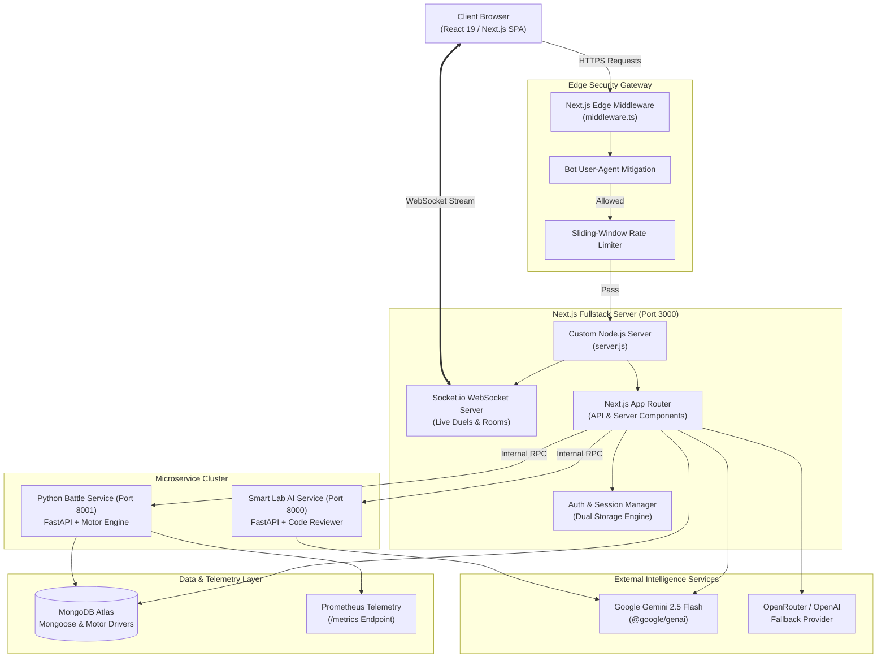
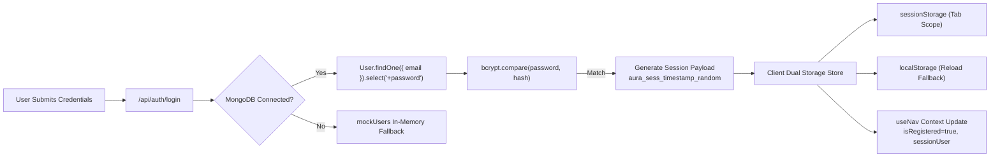
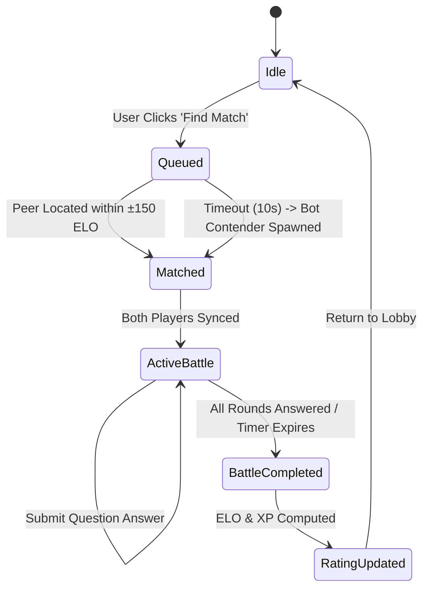
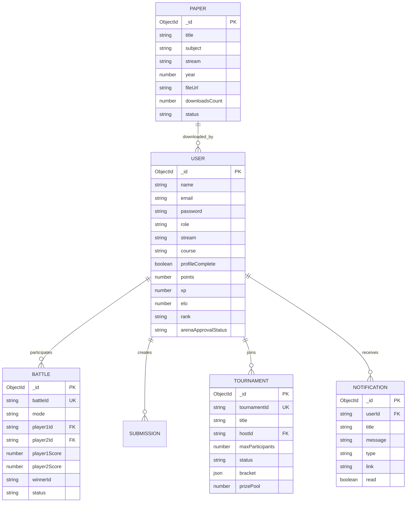
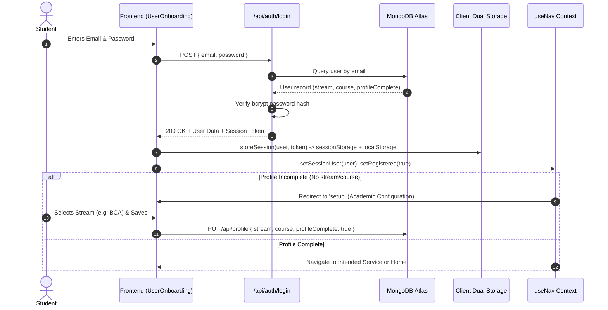
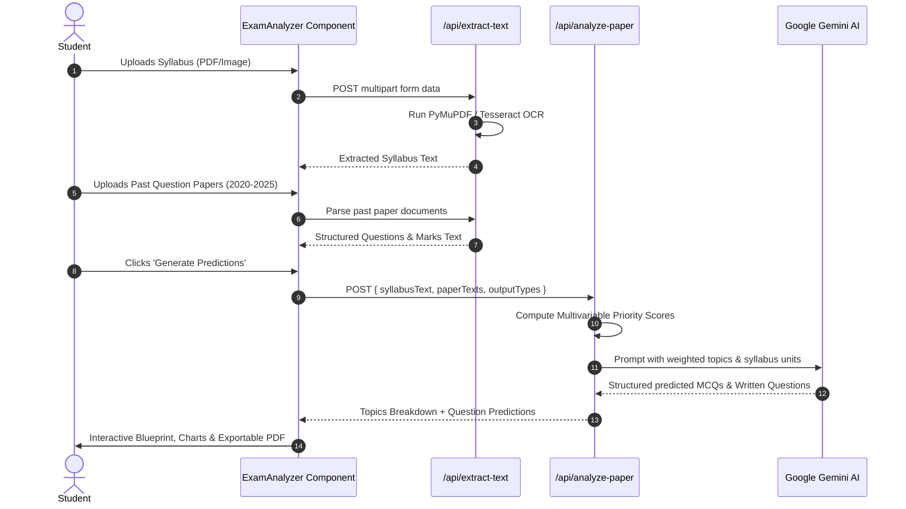
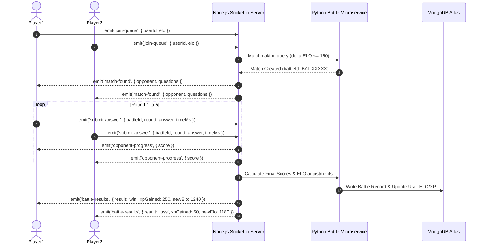
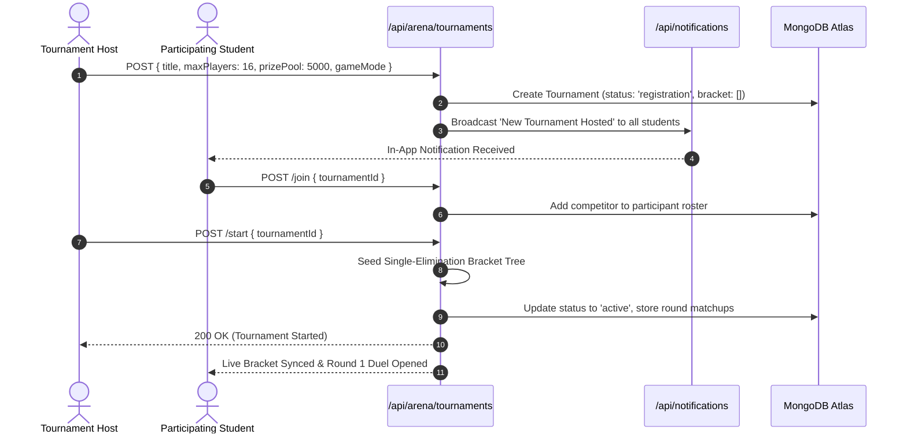
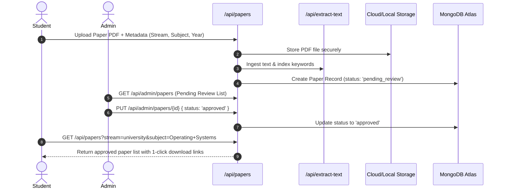

# 🎓 Aura Study AI — Platform Documentation & Architectural Specification

> **Next-Generation Academic Intelligence, Multivariable Exam Blueprint Engine, and Real-Time Algorithmic Battle Arena.**  
> *Built with Next.js 16, React 19, Tailwind CSS, MongoDB, and Python FastAPI Microservices.*

---

## 📑 Table of Contents
1. [Project Overview & Philosophy](#-project-overview--philosophy)
2. [Core Platform Verticals](#-core-platform-verticals)
3. [Project Directory Structure](#-project-directory-structure)
4. [High-Level Design (HLD)](#-high-level-design-hld)
5. [Low-Level Design (LLD)](#-low-level-design-lld)
   - [Authentication & Session Engine](#1-authentication--session-state-engine)
   - [Exam Pattern Analyzer Mathematical Model](#2-exam-pattern-analyzer--statistical-formulation)
   - [Real-Time Multiplayer Combat & Tournament Engine](#3-battle-arena--multiplayer-game-engine)
   - [Database Schemas & Data Models](#4-database-schemas--data-models)
   - [AI Smart Lab & Speech Interview Guider](#5-ai-smart-lab--technical-interview-guider)
6. [System Data Flows](#-system-data-flows)
   - [Data Flow 1: Authentication & Academic Onboarding](#flow-1-authentication-registration--academic-onboarding)
   - [Data Flow 2: Exam Blueprint & Prediction Pipeline](#flow-2-exam-blueprint--prediction-pipeline)
   - [Data Flow 3: 1v1 Real-Time Battle Arena](#flow-3-1v1-real-time-battle-arena-gameplay)
   - [Data Flow 4: Tournament Lifecycle & Bracket Seeding](#flow-4-tournament-lifecycle--bracket-seeding)
   - [Data Flow 5: Past Paper Upload & Community Repository](#flow-5-past-paper-upload--community-repository)
7. [API Specification & Endpoints](#-api-specification--endpoints)
8. [Environment Configuration & Local Setup](#-environment-configuration--local-setup)
9. [Automated Testing & Quality Assurance](#-automated-testing--quality-assurance)
10. [Academic Integrity & Disclaimers](#-academic-integrity--disclaimers)

---

## 🌟 Project Overview & Philosophy

**Aura Study AI** is an enterprise-grade academic intelligence and gamified educational ecosystem designed for university, engineering, and competitive examination candidates. The platform bridges the gap between passive memorization and active conceptual mastery through two symbiotic pillars:

1. **Multivariable Examination Analytics**: Deep document parsing, syllabus unit weighting, historical question trend modeling, and predictive blueprint generation.
2. **Multiplayer Algorithmic Arena**: High-velocity 1v1 duels, 2v2/3v3 team battles, private custom rooms, and bracketed tournaments that make theoretical preparation competitive and collaborative.

### The Timeless Ethos — वसुधैव कुटुम्बकम् (Vasudhaiva Kutumbakam)
The platform embodies the universal tenet **वसुधैव कुटुम्बकम्** (*"The Entire World is One Single Family"*). Built directly into the platform's continuous cultural carousel (`components/vision-slider.tsx`), ten philosophical pillars guide its engineering:
- **वसुधैव कुटुम्बकम्**: Transcending geographic barriers through universal, accessible education.
- **सा विद्या या विमुक्तये**: True education is that which liberates the intellect.
- **जल ही जीवन है (अमृत धारा)**: Ecological stewardship and environmental balance.
- **उत्तिष्ठत जाग्रत प्राप्य वरान्निबोधत**: Student spark, resilience, and unyielding ambition.
- **गुरुर्ब्रह्मा गुरुर्विष्णुः**: Honoring mentors, ethical educators, and moral compasses.
- **अनेकता में एकता (भारत का गौरव)**: Celebrating diversity and collective strength.
- **परोपकाराय सतां विभूतयः**: Service to humanity through accessible digital public goods.
- **माता भूमिः पुत्रोऽहं पृथिव्याः**: Harmonizing frontier AI with environmental responsibility.
- **विज्ञानं ब्रह्म**: Harnessing advanced artificial intelligence for human enlightenment.
- **सर्वे भवन्तु सुखिनः**: Universal prosperity, well-being, and peaceful collaboration.

---

## 🚀 Core Platform Verticals

```
                                  ┌───────────────────────────┐
                                  │       Aura Study AI       │
                                  └─────────────┬─────────────┘
          ┌─────────────────────┬───────────────┴───────────────┬─────────────────────┐
          ▼                     ▼                               ▼                     ▼
┌───────────────────┐ ┌───────────────────┐           ┌───────────────────┐ ┌───────────────────┐
│ Exam Blueprint    │ │ 1v1 Battle Arena  │           │ Smart Lab &       │ │ Community Paper   │
│ & Predictor Engine│ │ & Tournaments     │           │ Socratic Guider   │ │ Vault & Archive   │
└───────────────────┘ └───────────────────┘           └───────────────────┘ └───────────────────┘
```

1. **Exam Pattern Analyzer & Blueprint Engine**:
   - Dual-input workspace for syllabus hierarchies and historical question papers (PDF, scanned images, plain text).
   - Statistical topic frequency scoring, marks distribution breakdown, and recency weighting.
   - Comprehensive predicted practice suite with MCQs and written questions with marking rubrics.

2. **Multiplayer Algorithmic Battle Arena**:
   - **1v1 Matchmaking**: Real-time matchmaking against peers or automated AI sparring contenders.
   - **Team Battles (2v2 & 3v3)**: Cooperative multiplayer rounds with dynamic group progress indicators.
   - **Private Rooms (`PRIV-XXXXX`)**: Custom-room generation with optional passcodes and instant friend challenges.
   - **Tournament Arena**: 4- to 32-player bracketed tournaments with XP prize pools and automated bracket seeding.

3. **AI Smart Lab & Technical Interview Guider**:
   - Browser-based compiler with Monaco code editor supporting multiple programming runtimes.
   - Socratic AI debugging assistant delivering contextual hints without spoiling answers.
   - Voice-interactive mock interview simulator powered by speech recognition and natural language feedback.

4. **Community Repository & Paper Vault**:
   - Centralized repository of past university, board, and entrance examination papers.
   - Filterable by Stream, Course, Subject, and Academic Year with preview and one-click PDF download.

5. **Student Profile & Telemetry**:
   - Academic stream and course personalization (B.Tech, BCA, University, GATE, etc.).
   - Persistent battle records, ELO rating, level progression, and achievement badges.

6. **Admin Command Center**:
   - Master-cleared administration suite for managing users, approving arena permissions, inspecting database activity, and monitoring service telemetry.

---

## 📁 Project Directory Structure

```
c:\Local LLM
├── app/                                 # Next.js 16 App Router Core
│   ├── admin/                           # Master Admin Panel & Clearance Routes
│   │   ├── arena-approvals/             # Student arena access requests & review
│   │   ├── settings/                    # Admin configuration & system controls
│   │   ├── layout.tsx                   # Dedicated admin workspace layout
│   │   └── page.tsx                     # Administrative dashboard view
│   ├── api/                             # Serverless API Micro-handlers
│   │   ├── achievements/                # Student reward & badge tracking
│   │   ├── admin/                       # User management, approvals, DB telemetry
│   │   ├── ai/                          # Gemini proxy & prompt orchestration
│   │   ├── analytics/                   # Platform user behavior telemetry
│   │   ├── analyze-paper/               # Exam blueprint extraction & predictions
│   │   ├── arena/                       # Tournaments, duels, matchmaking state
│   │   ├── auth/                        # Login, registration, reset-password, nextauth
│   │   ├── chat/                        # Community chat messaging
│   │   ├── extract-text/                # PDF/Image text ingestion & OCR
│   │   ├── feedback/                    # Student bug & review feedback pipeline
│   │   ├── guider/                      # Socratic AI tutoring endpoint
│   │   ├── interview/                   # Technical interview generator & voice scoring
│   │   ├── lab/                         # Compiler sandbox, problem bank, submissions
│   │   ├── leaderboard/                 # Global rankings & XP tallies
│   │   ├── notifications/               # Real-time user alert dispatch
│   │   ├── papers/                      # Community paper upload, search & downloads
│   │   ├── profile/                     # Profile updates, avatar upload, stats mutation
│   │   ├── seed/                        # Database fixture populator
│   │   └── user/                        # Arena approval status & user points
│   ├── battle-arena/                    # Dedicated route fallback for battle invites
│   ├── data/                            # Static academic lookup datasets
│   ├── globals.css                      # Tailwind v4 theme, animations, dark mode
│   ├── layout.tsx                       # Root HTML shell, providers & global header
│   └── page.tsx                         # Unified Single Page Application (SPA) Router
│
├── components/                          # React 19 Client & UI Components
│   ├── admin-community.tsx              # Onboarding, Admin Panel, Community Vault, Chat
│   ├── developer-section.tsx            # System architectural credits & release notes
│   ├── exam-analyzer.tsx                # Blueprint Analyzer & Predictor workspace
│   ├── file-upload.tsx                  # Drag-and-drop file ingestion (PDF, Images, TXT)
│   ├── guider-agent.tsx                 # AI Socratic mentor conversational UI
│   ├── header.tsx                       # Sticky global navigation bar, stepper & profile menu
│   ├── home-hero-slider.tsx             # Interactive landing hero & feature redirect carousel
│   ├── interview-prep-workspace.tsx     # Voice mock interview simulator with speech synthesis
│   ├── notifications-center.tsx         # Real-time alert drawer with zero-friction redirects
│   ├── platform-vision.tsx              # Vasudhaiva Kutumbakam core philosophy showcase
│   ├── practice-platform-showcase.tsx   # Interactive compiler & 1v1 arena live demo
│   ├── question-predictor.tsx           # Predictive practice examination suite (MCQ/Written)
│   ├── smart-lab.tsx                    # Multi-language code runner with Monaco editor
│   ├── student-arena-request.tsx        # Suspended/pending arena appeal submission modal
│   ├── student-profile.tsx              # Student dashboard, academic stream setup & stats
│   ├── topic-analysis.tsx               # Statistical topic weights & distribution bar graphs
│   ├── vision-slider.tsx                # 10-theme cultural philosophy carousel
│   ├── battle-arena/                    # Battle Arena Sub-components
│   │   ├── battle-arena.tsx             # Arena container & mode selector
│   │   ├── live-battle.tsx              # Active 1v1 question stream, timer & score engine
│   │   ├── matchmaking-lobby.tsx        # Peer search, bot fallback & ready checks
│   │   ├── private-battle-room.tsx      # Room host/join (`PRIV-XXXXX`) & passcodes
│   │   ├── team-battle.tsx              # 2v2/3v3 cooperative multiplayer battle view
│   │   └── tournament-arena.tsx         # Tournament bracket tree & live event runner
│   └── ui/                              # Radix UI Primitives & Shadcn Components
│       ├── button.tsx, card.tsx, dialog.tsx, input.tsx, tabs.tsx, etc.
│
├── hooks/                               # React Custom Hooks
│   ├── use-nav.tsx                      # Navigation context, session guard & step state
│   ├── use-toast.ts                     # Toast alert state management
│   └── use-mobile.tsx                   # Responsive breakpoint detector
│
├── lib/                                 # Utility Modules, Drivers & Services
│   ├── auth.ts                          # NextAuth configuration & admin role verifier
│   ├── mockDb.ts                        # In-memory development resilience fallback
│   ├── mongodb.ts                       # Mongoose & native MongoDB connection pool
│   ├── ratelimit.ts                     # Sliding window in-memory rate limiter
│   ├── session-storage.ts               # Dual-sync sessionStorage & localStorage token manager
│   ├── utils.ts                         # Tailwind `cn` class merger & formatters
│   └── services/                        # Specialized Client/Server Services
│       ├── geminiService.ts             # Google Gemini Generative AI client
│       └── openaiService.ts             # OpenRouter / OpenAI API integrations
│
├── models/                              # Mongoose Schemas & MongoDB Entities
│   ├── Achievement.ts                   # Gamification badge definitions
│   ├── AnalyticsEvent.ts                # Telemetry event store
│   ├── ArenaQuestion.ts                 # Rapid-fire competitive question bank
│   ├── Battle.ts                        # Completed battle records & match logs
│   ├── ChatMessage.ts                   # Community chat room messages
│   ├── Notification.ts                  # User alerts, duel invites & tournament broadcasts
│   ├── Paper.ts                         # Past examination question papers
│   ├── Question.ts                      # Smart Lab coding challenge repository
│   ├── Submission.ts                    # Code execution logs & unit test scores
│   ├── Tournament.ts                    # Tournament events, brackets & player rosters
│   └── User.ts                          # Student & Admin account model (XP, ELO, stream)
│
├── python_service/                      # Python AI & Analytical Microservice (Port 8000)
│   ├── main.py                          # FastAPI endpoints for hints, reviews & debugging
│   └── requirements.txt                 # FastAPI, Uvicorn, Pydantic dependencies
│
├── server/battle-service/               # High-Throughput Battle Engine (Port 8001)
│   ├── config.py                        # Service settings, Redis & Mongo configurations
│   ├── grafana_dashboard.json           # Prometheus metrics visualization layout
│   ├── main.py                          # FastAPI WebSocket & REST router
│   ├── generators/                      # Procedural academic question generators
│   ├── repositories/                    # Motor async MongoDB repositories
│   ├── routes/                          # Questions, matchmaking, leaderboard, analyzer
│   ├── services/                        # ELO rating, matchmaking queue, cache, telemetry
│   └── requirements.txt                 # Motor, Prometheus, FastAPI, NumPy dependencies
│
├── middleware.ts                        # Next.js Edge Middleware (Bot blocking & rate limiting)
├── server.js                            # Custom Node.js HTTP & Socket.io Server (Port 3000)
├── next.config.mjs                      # Next.js compilation config & headers
├── package.json                         # Node dependencies & package scripts
├── tsconfig.json                        # Strict TypeScript compilation rules
└── README.md                            # Complete Project Architectural Documentation
```

---

## 🏛️ High-Level Design (HLD)

### System Architecture Diagram



### Architectural Principles & Topology
1. **Unified SPA User Experience**:
   - The application runs as a responsive single-page application orchestrating views via `hooks/use-nav.tsx` while supporting direct deep links (e.g., `/?step=arena`, `/?step=lab`, `/battle-arena`).
2. **Layered Defense-in-Depth**:
   - **Edge Tier**: Evaluates incoming request headers before touching Node.js runtime. Blocks scanner tools (`sqlmap`, `nikto`, `masscan`, `nmap`) and applies IP-based rate tiers (5 req/min on Auth, 20 req/min on Writes, 60 req/min on Reads).
   - **Application Tier**: NextAuth and cryptographic custom token verification (`aura_sess_*`).
   - **Data Tier**: Schema validation via Mongoose, parameterized queries, and bcrypt salt hashing.
3. **Hybrid Microservice Architecture**:
   - High-throughput multiplayer matchmaking and game loops are delegated to a dedicated Python FastAPI service running async Motor drivers on port `8001`.
   - Node.js server handles document parsing, Next.js rendering, and Socket.io client connections on port `3000`.

---

## 🔧 Low-Level Design (LLD)

### 1. Authentication & Session State Engine



#### Dual Session Synchronization (`lib/session-storage.ts` & `hooks/use-nav.tsx`)
To prevent session loss across browser reloads or multiple opened tabs while maintaining strict guest protection:
- **Write Path**: When credentials are validated, `storeSession()` persists `AuraSessionData` with an active token to **both** `sessionStorage` and `localStorage`.
- **Read Path**: On application mount, `getStoredSession()` inspects `sessionStorage`. If empty (new browser tab), it recovers state from `localStorage` and mirrors it back to `sessionStorage`.
- **Sign Out Path**: `clearStoredSession()` actively purges keys from both stores, preventing lingering credentials on shared computers.
- **Academic Setup Guard**: If a user's academic profile is incomplete, they are routed to the Academic Setup wizard; however, authenticated users maintain immediate access to AI services.

---

### 2. Exam Pattern Analyzer & Statistical Formulation

#### Multivariable Weighting Equation
The Blueprint Engine extracts topics from the syllabus and historical question papers, evaluating each topic $i$ through five multivariable parameters:

$$\text{Priority Score}(i) = w_a \cdot S_{\text{appearance}}(i) + w_r \cdot S_{\text{recency}}(i) + w_m \cdot S_{\text{marks}}(i) + w_t \cdot S_{\text{trend}}(i) + w_c \cdot S_{\text{coverage}}(i)$$

Where:
- $w_a = 0.30$ (Appearance Frequency): Ratio of examination papers containing topic $i$.
- $w_r = 0.20$ (Recency Weight): Exponential decay favoring appearances in recent academic sessions:
  $$S_{\text{recency}}(i) = \frac{\sum_{y \in Y_i} e^{-\lambda (Y_{\text{current}} - y)}}{|Y_i|}, \quad \lambda = 0.15$$
- $w_m = 0.20$ (Marks Density): Average percentage of total examination marks allocated to topic $i$.
- $w_t = 0.15$ (Temporal Trend Velocity): Linear regression slope of topic appearances over the last 3–5 years.
- $w_c = 0.15$ (Syllabus Unit Coverage): Relative importance specified by course curriculum guidelines.

#### Predictive Question Synthesis
- **MCQ Generator**: Synthesizes 4-choice objective questions with explicit distractors, difficulty tags, and underlying theoretical justification.
- **Written Question Generator**: Constructs descriptive short and long questions accompanied by a step-by-step model answer and rubric verification checklist.

---

### 3. Battle Arena & Multiplayer Game Engine

#### Matchmaking State Machine



#### ELO Rating Adjustment Formulation
When a battle concludes between Player A ($R_A$) and Player B ($R_B$):

$$E_A = \frac{1}{1 + 10^{(R_B - R_A)/400}}, \quad E_B = \frac{1}{1 + 10^{(R_A - R_B)/400}}$$

$$R'_A = R_A + K \cdot (S_A - E_A), \quad R'_B = R_B + K \cdot (S_B - E_B)$$

Where:
- $K = 32$ for novice players ($< 1400$ ELO), $K = 16$ for seasoned competitors.
- $S_A = 1$ (Win), $0.5$ (Draw), $0$ (Loss).
- Bonus XP multipliers are awarded for active win streaks ($+10\%$ per consecutive win up to $+50\%$).

---

### 4. Database Schemas & Data Models



---

### 5. AI Smart Lab & Technical Interview Guider

The Smart Lab combines Monaco code editing with an isolated execution environment and Socratic feedback loops:
1. **Interactive Compiler**: Code written in C++, Python, JavaScript, Java, or Go is sent to `/api/lab/execution` where unit tests validate output against boundary conditions.
2. **Socratic AI Guider**: Instead of giving raw answers, the AI Guider (`components/guider-agent.tsx`) evaluates student queries against the current source code and prompts them with conceptual hints.
3. **Voice Mock Interviewer**: Integrates Web Speech API (`webkitSpeechRecognition`) with the Google Gemini API to conduct realistic verbal interviews. Evaluates technical accuracy, communication clarity, and problem-solving structure.

---

## 🔄 System Data Flows

### Flow 1: Authentication, Registration & Academic Onboarding



---

### Flow 2: Exam Blueprint & Prediction Pipeline



---

### Flow 3: 1v1 Real-Time Battle Arena Gameplay



---

### Flow 4: Tournament Lifecycle & Bracket Seeding



---

### Flow 5: Past Paper Upload & Community Repository



---

## 📡 API Specification & Endpoints

### 1. Authentication & User Management
| Method | Endpoint | Description | Auth Required |
|---|---|---|---|
| `POST` | `/api/auth/register` | Register student account with email, phone & password | No |
| `POST` | `/api/auth/login` | Authenticate student/admin credentials and issue session token | No |
| `POST` | `/api/auth/reset-password`| Reset forgotten password via phone verification | No |
| `GET`  | `/api/auth/session` | Inspect active NextAuth server session | No |
| `GET`  | `/api/profile` | Retrieve student profile, stats, XP, and rank | Yes |
| `PUT`  | `/api/profile` | Update profile details (photo, bio, stream, course) | Yes |

### 2. Exam Blueprint & Intelligence
| Method | Endpoint | Description | Auth Required |
|---|---|---|---|
| `POST` | `/api/extract-text` | Extract text from PDF documents or images via OCR | Yes |
| `POST` | `/api/analyze-paper` | Compute multivariable topic weights & predict questions | Yes |
| `GET`  | `/api/papers` | Search approved community question papers | Yes |
| `POST` | `/api/papers/upload` | Upload past question paper for community review | Yes |
| `GET`  | `/api/papers/download` | Securely download question paper PDF | Yes |

### 3. Multiplayer Battle Arena
| Method | Endpoint | Description | Auth Required |
|---|---|---|---|
| `GET`  | `/api/arena/tournaments` | List active, scheduled, and completed tournaments | Yes |
| `POST` | `/api/arena/tournaments` | Create and host a new competitive tournament | Yes |
| `POST` | `/api/arena/tournaments/join` | Join tournament roster | Yes |
| `POST` | `/api/arena/tournaments/start`| Seed bracket and launch tournament (Host only) | Yes |
| `GET`  | `/api/user/arena-status` | Check student arena clearance status | Yes |
| `POST` | `/api/notifications` | Fetch user alerts & duel invites | Yes |

### 4. Smart Lab & AI Microservices
| Method | Endpoint | Port | Description |
|---|---|---|---|
| `POST` | `/api/lab/execution` | 3000 | Sandboxed code execution & unit test evaluation |
| `POST` | `/api/ai/hint` | 8000 | Generate conceptual Socratic hint for current code |
| `POST` | `/api/ai/debug` | 8000 | Identify syntax and logical flaws in student code |
| `POST` | `/api/ai/feedback` | 8000 | Quantitative scoring of mock interview responses |
| `GET`  | `/metrics` | 8001 | Prometheus metrics for battle engine throughput |

---

## ⚙️ Environment Configuration & Local Setup

### Environment Variables (`.env`)

```env
# Application URLs & Ports
APP_URL=http://localhost:3000/
CORS_ORIGINS=http://localhost:3000,http://localhost:3001
AI_SERVICE_URL=http://localhost:8000
BATTLE_SERVICE_URL=http://localhost:8001

# Database Configuration
MONGODB_URI=mongodb+srv://<username>:<password>@cluster.mongodb.net/aurastudy?retryWrites=true&w=majority

# Security & Secrets
NEXTAUTH_SECRET=your-nextauth-secret-key-here
ADMIN_PASSWORD=your_admin_master_password_hash
ADMIN_SESSION_SECRET=your_admin_session_secret

# AI Providers
GEMINI_API_KEY=AIzaSy...
GOOGLE_GENERATIVE_AI_API_KEY=AIzaSy...
GEMINI_MODEL=gemini-2.5-flash
GEMINI_TIMEOUT=60000
GEMINI_MAX_TOKENS=8192
GEMINI_TEMPERATURE=0.7
OPEN_ROUTER_API_KEY=sk-or-v1-...

# Support & Identity
NEXT_PUBLIC_SUPPORT_EMAIL=helpsupport9452@gmail.com
NEXT_PUBLIC_APP_VERSION=2.0
```

### Step-by-Step Installation

#### 1. Clone the Repository & Install Node Dependencies
```bash
git clone https://github.com/your-org/aura-study-ai.git
cd aura-study-ai
npm install
```

#### 2. Start the Python AI Microservice (Port 8000)
```bash
cd python_service
pip install -r requirements.txt
uvicorn main:app --port 8000 --reload
```

#### 3. Start the Python Battle Microservice (Port 8001)
```bash
cd server/battle-service
pip install -r requirements.txt
python run_server.py
```

#### 4. Launch the Next.js Fullstack Server (Port 3000)
```bash
# In the root project directory:
npm run dev
```
Navigate to [http://localhost:3000](http://localhost:3000) in your web browser.

---

## 🧪 Automated Testing & Quality Assurance

The platform includes an automated end-to-end integration and platform test harness validating all critical user paths:

```bash
# Run comprehensive automated test suite (25 test specifications)
npm test
```

### What `npm test` Validates:
1. **Edge Bot Filtering**: Verifies automated scanner user agents are intercepted with HTTP 403.
2. **Authentication Flow**: Tests registration, credentials login, session tokens, and input sanitization.
3. **Session Restoration**: Confirms persistent storage synchronization across sessionStorage and localStorage.
4. **Exam Analyzer Pipeline**: Tests syllabus topic extraction, weight computation, and prediction fallbacks.
5. **Multiplayer Matchmaking**: Validates duel creation, queue state, bot fallback, and ELO calculations.
6. **Tournament System**: Verifies tournament creation, player joining, and single-elimination bracket seeding.

---

## 📜 Academic Integrity & Disclaimers

1. **Intended Purpose**: Aura Study AI is engineered strictly as an educational study companion, statistical practice tool, and collaborative learning arena.
2. **Statistical Disclaimer**: All syllabus weights, question probabilities, and predicted exam patterns represent mathematical and historical estimates to guide revision. They do not constitute official university examination leaks or guaranteed question contents.
3. **Intellectual Property**: University syllabus materials, past question papers, and marks schemes belong to their respective educational boards and universities.

---

<p align="center">
  <strong>Aura Study AI</strong> • Vasudhaiva Kutumbakam (वसुधैव कुटुम्बकम्) • <em>Empowering Students Worldwide</em>
</p>
